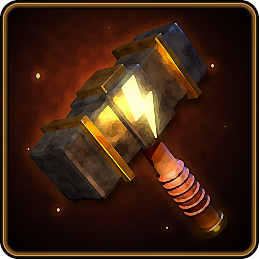
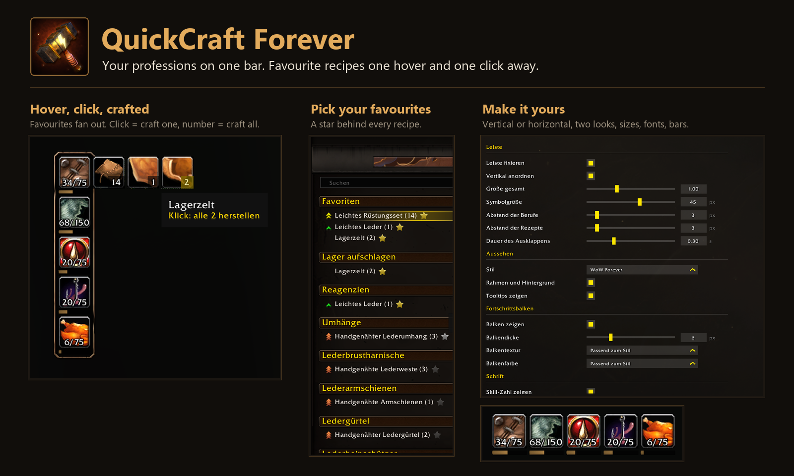

# QuickCraft Forever

A profession bar for **WoW: Forever**. Your professions sit on one small bar, and the recipes you use
most are one hover and one click away, without opening the profession window.

## What it does

- **One icon per profession**, with a skill progress bar and the skill number (for example `31/75`).
- **Click** an icon to open that profession. Click it again to close it.
- **Hover** an icon and your favorite recipes for that profession fan out next to it.
  - Click a recipe to craft **one**.
  - Click the **number** on it to craft **all** your bags allow.
  - The number updates as you pick up materials, even while the profession window is closed.
  - A recipe you lack materials for is greyed out. Its tooltip lists what is missing.
- **Favorites** are the game's own recipe favorites. The addon puts a star next to every learned recipe
  in the profession window: click it to add or remove the recipe.

## Setup

1. Open a profession and click the star next to the recipes you want on the bar.
2. Type `/qc` for the options, or find **QuickCraft Forever** under Options > AddOns.
3. Unlock the bar there (or with `/qc unlock`), drag it where you want it, and lock it again.

The recipes fan out toward the middle of the screen: left or right from a vertical bar, up or down from
a horizontal one.

## Options

- Horizontal or vertical layout, overall scale, icon size, spacing.
- Two looks: **WoW Forever** (the bronze frame and bars of the default interface) and **EllesmereUI**
  (dark panel, thin edges, cropped icons). Either with or without a frame.
- Progress bar: on or off, thickness, texture, color.
- Font face and size. "Automatic" follows EllesmereUI's font when that addon is installed.
- Animation speed, tooltips on or off.

Bar textures and fonts registered with LibSharedMedia show up in the lists when another addon brings
that library along. QuickCraft Forever needs no other addon.

## Commands

| Command | What it does |
| --- | --- |
| `/qc` or `/quickcraft` | Open the options |
| `/qc lock`, `/qc unlock` | Lock or unlock the bar |
| `/qc reset` | Put the bar back to its default position |
| `/qc mark` | Toggle the favorite on the recipe the profession window shows |
| `/qc debug` | Turn the debug log on or off |
| `/qc log` | Show the log window |
| `/qc dump` | Write the addon's state into the log (for bug reports) |

## How crafting without the window works

Worth knowing, because it is unusual:

- The game only crafts from a profession that is loaded, and it unloads a profession when its window
  closes. So when you hover a profession icon, the addon asks the game to load that profession and, for
  that moment, keeps the frames that would open the profession window from hearing about it. This
  includes other addons' frames that listen to the same event; they get it again the next time.
- A click then calls the game's craft function directly. The profession is unloaded again shortly after
  the recipes fold away, unless a craft is still running.
- Nothing is loaded while you are casting, and nothing happens in combat.

If the profession window opens anyway on your setup, the addon notices and stops loading on hover for
the session; a click then opens the window and crafts.

## Reporting a problem

Type `/qc debug`, reproduce the problem, type `/qc dump`, then copy the text from the log window
(click into it, Ctrl+A, Ctrl+C) into an [issue](https://github.com/Zaho92/QuickCraftForever/issues).

## Languages

English and German.

## License

[MIT](LICENSE)
